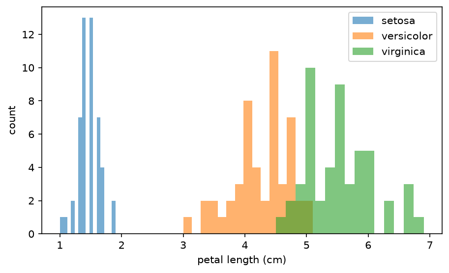
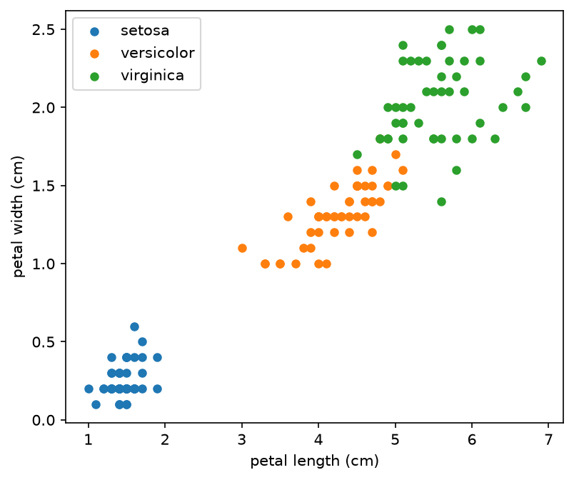
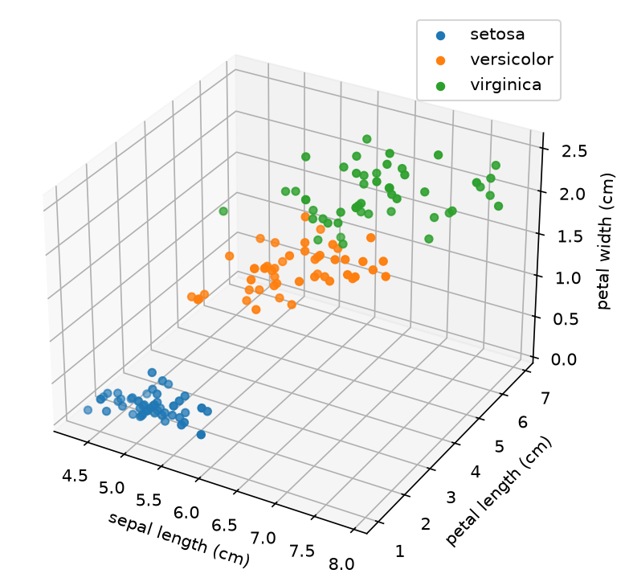
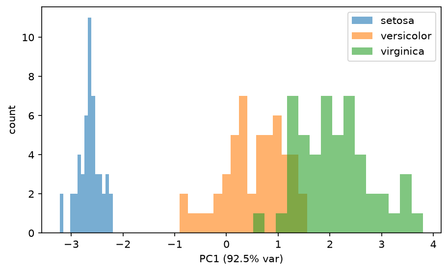
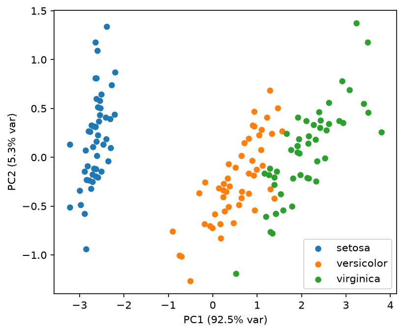
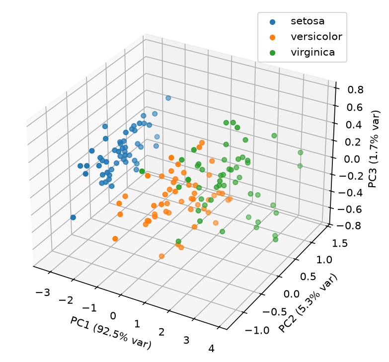
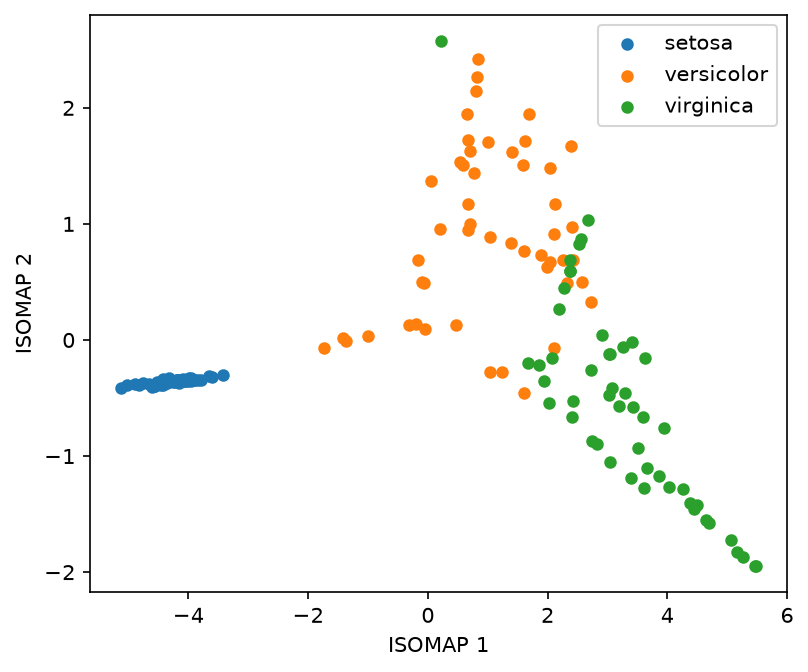
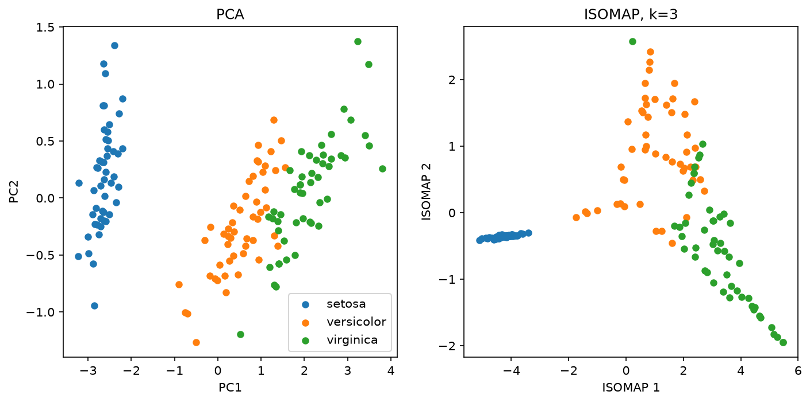
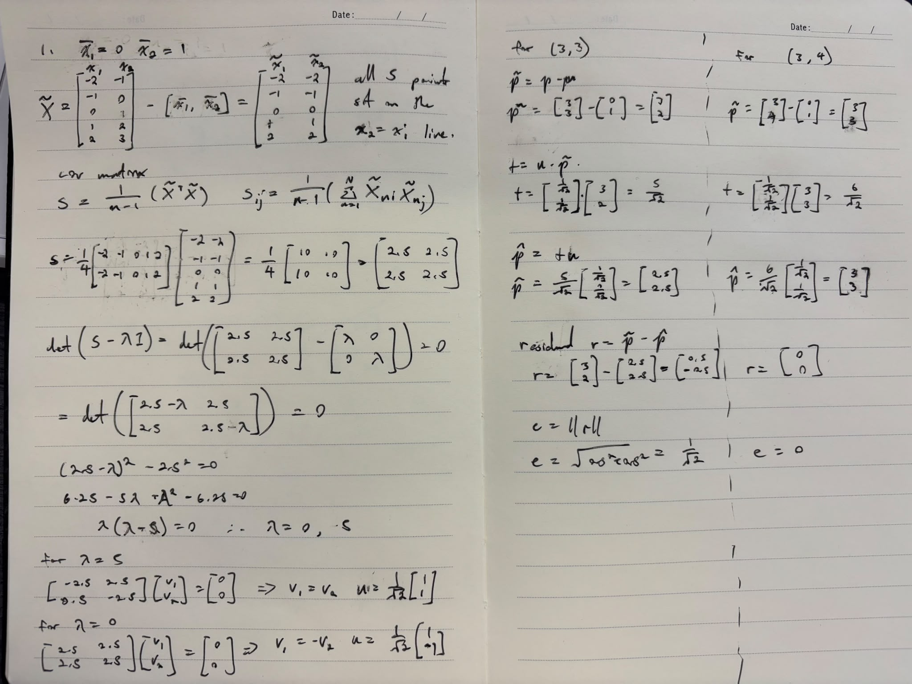

This assignment is about reducing the number of dimensions in a dataset while throwing away as little as possible. Part 1 works through PCA by hand on a five point dataset. Parts 2 to 5 use the Iris dataset, plotting raw feature combinations, running PCA on it, measuring how much the reduced version keeps, and comparing PCA against ISOMAP, a nonlinear alternative.

## PCA

Principal component analysis (PCA) finds the directions along which a dataset varies the most and describes each point by where it sits along those directions rather than by all of its original features. A **principal component** (PC) is one of those directions, a unit vector in the original feature space. The first PC is the direction of greatest variance, the second the direction of greatest remaining variance perpendicular to the first, and so on.

The procedure:

1. **Center** the data by subtracting the mean of each feature. PCA measures variance around the mean, so this step is not optional.
2. Form the **covariance matrix** $\mathbf{S}$ of the centered data. Entry $S_{ij}$ is the covariance between features $i$ and $j$, a measure of how much the two move together, and $S_{ii}$ is the ordinary variance of feature $i$.
3. Take the **eigenvectors** of $\mathbf{S}$. An eigenvector $\mathbf{v}$ with eigenvalue $\lambda$ satisfies $\mathbf{S}\mathbf{v} = \lambda\mathbf{v}$, a direction the matrix stretches without rotating. These are the principal components, and each eigenvalue is the variance along its own eigenvector. $\mathbf{S}$ is symmetric, so they come out orthogonal and can be scaled to unit length, which is the $\lVert \mathbf{w} \rVert = 1$ the handout assumes.

To **project** a centered point $\tilde{\mathbf{x}}$ onto a unit PC $\mathbf{u}$, take $t = \mathbf{u}^{\mathsf{T}}\tilde{\mathbf{x}}$, the signed distance along $\mathbf{u}$ of the nearest point on that line. That single number is the compressed form of the point. **Reconstructing** is $\hat{\mathbf{x}} = t\mathbf{u}$, and the **reconstruction error** is the L2 norm (straight line length $\lVert \mathbf{v} \rVert = \sqrt{v_1^2 + \cdots + v_d^2}$) of what is left:

$$e(\mathbf{x}) = \big\lVert \tilde{\mathbf{x}} - (\mathbf{u}^{\mathsf{T}}\tilde{\mathbf{x}})\,\mathbf{u} \big\rVert$$

This is the perpendicular distance from the point to the PC line. Minimizing orthogonal distance and maximizing variance therefore pick the same direction, since the two squared totals add to a constant.

## Part 1: PCA by hand

### The data

| $x_1$ | $x_2$ |
| --- | --- |
| -2 | -1 |
| -1 | 0 |
| 0 | 1 |
| 1 | 2 |
| 2 | 3 |

### Centering

$$\mu_1 = \frac{-2 - 1 + 0 + 1 + 2}{5} = 0, \qquad \mu_2 = \frac{-1 + 0 + 1 + 2 + 3}{5} = 1$$

Subtracting $(\mu_1, \mu_2) = (0, 1)$ from every row gives the centered data:

$$\tilde{\mathbf{X}} = \begin{bmatrix} -2 & -2 \\ -1 & -1 \\ 0 & 0 \\ 1 & 1 \\ 2 & 2 \end{bmatrix}$$

Every centered row has the form $(k, k)$, so all five points lie exactly on the line $\tilde{x}_2 = \tilde{x}_1$, which is $x_2 = x_1 + 1$ in the original coordinates. There is no spread in the perpendicular direction.

### Covariance matrix

With $N = 5$ points and the $N - 1$ denominator:

$$\mathbf{S} = \frac{1}{N-1}\tilde{\mathbf{X}}^{\mathsf{T}}\tilde{\mathbf{X}} = \frac{1}{4}\begin{bmatrix} 10 & 10 \\ 10 & 10 \end{bmatrix} = \begin{bmatrix} 2.5 & 2.5 \\ 2.5 & 2.5 \end{bmatrix}$$

since $\sum \tilde{x}_1^2 = \sum \tilde{x}_1\tilde{x}_2 = \sum \tilde{x}_2^2 = 4 + 1 + 0 + 1 + 4 = 10$.

NOTE: using $1/N$ instead of $1/(N-1)$ scales every entry by $4/5$, and both eigenvalues with it, but leaves the eigenvectors unchanged.

### Eigenvalues and eigenvectors

$$\det(\mathbf{S} - \lambda\mathbf{I}) = (2.5 - \lambda)^2 - 2.5^2 = \lambda^2 - 5\lambda = \lambda(\lambda - 5)$$

so $\lambda_1 = 5$ and $\lambda_2 = 0$. For $\lambda_1 = 5$:

$$(\mathbf{S} - 5\mathbf{I})\mathbf{v} = \begin{bmatrix} -2.5 & 2.5 \\ 2.5 & -2.5 \end{bmatrix}\begin{bmatrix} v_1 \\ v_2 \end{bmatrix} = \mathbf{0} \quad \Longrightarrow \quad v_1 = v_2$$

### 1. The first principal component

Any multiple of $(1, 1)$ is an eigenvector, and normalizing to unit length gives

$$\mathbf{u} = \frac{1}{\sqrt{2}}\begin{bmatrix} 1 \\ 1 \end{bmatrix} \approx \begin{bmatrix} 0.7071 \\ 0.7071 \end{bmatrix}$$

The sign is arbitrary, since $-\mathbf{u}$ is an equally valid eigenvector and describes the same line.

The second eigenvalue is exactly zero, so there is no variance perpendicular to $\mathbf{u}$. The first PC captures 100% of it and one number describes each point.

### 2. Reconstruction error of $(3, 3)$

Center the query point using the same mean as the training data, $(0, 1)$:

$$\tilde{\mathbf{p}} = (3, 3) - (0, 1) = (3, 2)$$

Project onto $\mathbf{u}$:

$$t = \mathbf{u}^{\mathsf{T}}\tilde{\mathbf{p}} = \frac{1}{\sqrt{2}}(3 + 2) = \frac{5}{\sqrt{2}} \approx 3.5355$$

Reconstruct:

$$\hat{\mathbf{p}} = t\,\mathbf{u} = \frac{5}{\sqrt{2}} \cdot \frac{1}{\sqrt{2}}\begin{bmatrix} 1 \\ 1 \end{bmatrix} = \begin{bmatrix} 2.5 \\ 2.5 \end{bmatrix}$$

The residual and its length:

$$\tilde{\mathbf{p}} - \hat{\mathbf{p}} = (3 - 2.5,\; 2 - 2.5) = (0.5,\, -0.5)$$

$$e = \sqrt{0.5^2 + (-0.5)^2} = \sqrt{0.5} = \frac{1}{\sqrt{2}} \approx 0.7071$$

As a check, the perpendicular distance from a point to the line $x_2 = x_1 + 1$ is $|x_1 - x_2 + 1| / \sqrt{2}$, which gives $|3 - 3 + 1| / \sqrt{2} = 0.7071$.

### 3. Reconstruction error of $(3, 4)$

$$\tilde{\mathbf{p}} = (3, 4) - (0, 1) = (3, 3)$$

$$t = \frac{1}{\sqrt{2}}(3 + 3) = \frac{6}{\sqrt{2}} = 3\sqrt{2}$$

$$\hat{\mathbf{p}} = 3\sqrt{2} \cdot \frac{1}{\sqrt{2}}\begin{bmatrix} 1 \\ 1 \end{bmatrix} = \begin{bmatrix} 3 \\ 3 \end{bmatrix}$$

The residual is exactly $(0, 0)$, so

$$e = 0$$

$(3, 4)$ satisfies $x_2 = x_1 + 1$, so it lies on the same line as all five training points and the one dimensional representation loses nothing. $(3, 3)$ sits one unit off that line, and $1/\sqrt{2}$ is its perpendicular distance to it. Compression is lossless exactly on the subspace PCA selected and lossy everywhere else.

### Numerical check

```python
X = np.array([
    [-2, -1],
    [-1, 0],
    [0, 1],
    [1, 2],
    [2, 3]
], dtype=float)

mu = X.mean(axis=0)
Xc = X - mu

C = np.cov(Xc, rowvar=False)
vals, vecs = np.linalg.eigh(C) # eigen decomposition
u = vecs[:, -1]

def recon_error(p):
    p = np.asarray(p, dtype=float)
    pc = p - mu
    t = pc @ u
    recon = t * u
    residual = pc - recon
    return np.linalg.norm(residual)

print(mu, vals, u)
print(recon_error([3, 3]), recon_error([3, 4]))
```

`np.linalg.eigh` is the eigendecomposition routine for symmetric matrices. It returns real eigenvalues in ascending order and orthonormal eigenvectors as columns, so the first PC is the last column. The general `np.linalg.eig` guarantees neither.

Output:

```
[0. 1.] [0. 5.] [0.70710678 0.70710678]
0.7071067811865476 6.280369834735101e-16
```

The eigenvalues are $0$ and $5$, the first PC is $(0.7071, 0.7071)$, and the errors are $0.7071$ and $6.3 \times 10^{-16}$, floating point zero. All three agree with the hand calculation.

## The Iris dataset

Parts 2 to 5 use the Iris dataset: 150 flowers, 4 measurements each in centimetres, labelled with one of 3 species, 50 each. PCA and ISOMAP are both unsupervised, meaning they see only the features, so the labels never enter a fit. They colour the plots, so we can check whether the structure found without them lines up with the species.

```python
iris = load_iris()
X, y = iris.data, iris.target
names, species = iris.feature_names, iris.target_names
colors = ["tab:blue", "tab:orange", "tab:green"]
print(X.shape, names, species)
```

`X` is $150 \times 4$ and `y` holds 150 integers in $\{0, 1, 2\}$ for setosa, versicolor and virginica. This is the same data as the UCI copy the handout links to.

The four features, and how much of the total variance each holds:

| Index | Feature | Variance | Share of total |
| --- | --- | --- | --- |
| 0 | sepal length | 0.6857 | 14.99% |
| 1 | sepal width | 0.1900 | 4.15% |
| 2 | petal length | 3.1163 | 68.15% |
| 3 | petal width | 0.5810 | 12.71% |
| | **total** | **4.5730** | 100% |

Petal length alone holds more than two thirds of it.

## Part 2: Data visualization

Marginalizing means dropping feature dimensions and keeping the rest, which in code is column selection on `X`. The plots below use one, two and three of the four.

### One feature: petal length

A scatter needs two axes, so a single feature is shown as a histogram per species, with transparency so overlaps are visible.



Setosa occupies 1.0 to 1.9 cm and nothing else appears below 3.0 cm, so a single threshold in that gap separates it from the other 100 flowers with no errors. Versicolor (3.0 to 5.1 cm) and virginica (4.5 to 6.9 cm) overlap between 4.5 and 5.1. 2 versicolor sit above 4.9 cm and 6 virginica below 5.0, so about 8 of those 100 cannot be assigned on petal length alone.

### Two features: petal length and petal width



Setosa is isolated in the bottom left with a wide margin in both directions. Versicolor and virginica form elongated groups along a common diagonal, since long petals are also wide petals. They touch near $(5, 1.7)$, but a diagonal line separates almost all of them, better than either feature alone.

### Three features: sepal length, petal length, petal width



The groups sit in the same arrangement as the 2D plot, stretched along the sepal length axis. Versicolor spans 4.9 to 7.0 cm on that axis and virginica 4.9 to 7.9 cm, almost entirely overlapping, so the petal measurements are still doing the separating.

### Comment

The petal marginalizations give clean clusters and the sepal ones do not. Any plot containing petal length separates setosa perfectly, since the gap between 1.9 and 3.0 cm is the largest structure in the dataset. Separating versicolor from virginica is the harder problem, and it needs both petal measurements.

Sepal width is the weakest of the four at 4.15% of the total variance, and it runs against the other three. Setosa has the *widest* sepals (mean 3.428 cm) while being smallest in every other measurement. The dataset is not really four dimensional.

## Part 3: PCA

```python
pca = PCA(n_components=3).fit(X)
Z = pca.transform(X)
ratio = pca.explained_variance_ratio_

axes = pd.DataFrame(pca.components_, columns=names, index=["PC1", "PC2", "PC3"])
print(axes.round(4))
print(ratio.round(4), ratio.cumsum().round(4))
```

`fit` computes the mean and the principal components, `transform` returns `Z` (row $n$ holds flower $n$'s projections onto PC1, PC2 and PC3), and `pca.components_` holds the PC vectors themselves in the original feature space.

NOTE: `PCA` centers but does not rescale, and the features are left unstandardized. All four are centimetre measurements of the same kind of object, so their variances are comparable and rescaling would discard real information about which one varies more. Standardizing gives 72.96% of variance on PC1 instead of 92.46%, since it promotes sepal width from 4.15% of the total to 25%.

### The PCA axes

Each row is one principal component, given as the weights on the four original features:

| | sepal length | sepal width | petal length | petal width |
| --- | --- | --- | --- | --- |
| **PC1** | 0.3614 | -0.0845 | 0.8567 | 0.3583 |
| **PC2** | 0.6566 | 0.7302 | -0.1734 | -0.0755 |
| **PC3** | -0.5820 | 0.5979 | 0.0762 | 0.5458 |

PC1 is dominated by petal length at $0.8567$, with the other size measurements positive and sepal width slightly negative, so it reads as overall petal size. The direction of greatest variance is essentially the feature that already separated the species in Part 2. PC2 is mostly sepal length and width together ($0.6566$ and $0.7302$) with the petal terms near zero, an overall sepal size axis, perpendicular to the first by construction.

| Component | Variance explained | Cumulative |
| --- | --- | --- |
| PC1 | 92.46% | 92.46% |
| PC2 | 5.31% | 97.77% |
| PC3 | 1.71% | 99.48% |

### Marginalized on the major axis



Projecting onto PC1 alone keeps 92.46% of the variance and reduces each flower to one number. Setosa separates completely, its PC1 values topping out at $-2.1998$ while nothing else goes below $-0.9065$. Versicolor spans $-0.906$ to $1.558$ and virginica $0.521$ to $3.796$, overlapping in a band in the middle, the same pair that overlapped on raw petal length.

### Top two axes



The two dimensional representation keeps 97.77% of the variance. Nearly all of the separation is still horizontal. PC2 spreads each species vertically without pulling them apart, on a 5.31% share. Versicolor and virginica remain adjacent with a small overlap near $\text{PC1} \approx 1.2$.

### Top three axes



Adding PC3 takes the total to 99.48%. It spans about $-0.8$ to $0.8$, an order of magnitude narrower than PC1, and the species are thoroughly mixed along it, so it contributes nothing to telling them apart.

## Part 4: Data compression

The Frobenius norm of a matrix is the square root of the sum of the squares of all its entries, $\lVert \mathbf{A} \rVert_F = \sqrt{\sum_{i,j} A_{ij}^2}$. For centered data this connects directly to variance, because the variance of feature $j$ is $\frac{1}{N-1}\sum_n \tilde{x}_{nj}^2$ and summing over all features gives

$$\sum_{j=1}^{D} \operatorname{Var}(x_j) = \frac{1}{N-1} \lVert \tilde{\mathbf{X}} \rVert_F^2 = \operatorname{tr}(\mathbf{S}) = \sum_{j=1}^{D} \lambda_j$$

The trace of a matrix (the sum of its diagonal entries) equals the sum of its eigenvalues. Total variance can therefore be split two ways, across the original features or across the principal components, and both add to the same number. PC $j$'s share is $\lambda_j / \sum_k \lambda_k$, and since PCA keeps the largest eigenvalues first, dropping the rest discards the least possible.

```python
pca_full = PCA().fit(X)
ratio_full = pca_full.explained_variance_ratio_
cumulative = ratio_full.cumsum()
print(ratio_full.round(4))
print(cumulative.round(4))

print("2D representation explains:", f"{cumulative[1]:.2%}")
print("PCs needed for 50%:", int(np.searchsorted(cumulative, 0.5) + 1))

Xc = X - X.mean(axis=0)
frob_sq = (Xc ** 2).sum()
total_var = frob_sq / (len(X) - 1)
eigen_sum = pca_full.explained_variance_.sum()
print(total_var, eigen_sum, np.allclose(total_var, eigen_sum))
```

`PCA()` with no `n_components` keeps all four, which the second question needs. `np.searchsorted(cumulative, 0.5)` returns the first index at which the running total reaches 0.5, and adding 1 turns an index into a count.

Output:

```
[0.9246 0.0531 0.0171 0.0052]
[0.9246 0.9777 0.9948 1.    ]
2D representation explains: 97.77%
PCs needed for 50%: 1
4.572957046979866 4.572957046979804 True
```

The last line checks the identity above numerically. $\lVert \tilde{\mathbf{X}} \rVert_F^2 / (N-1) = 4.5730$ and $\sum_j \lambda_j = 4.2282 + 0.2427 + 0.0782 + 0.0238 = 4.5730$, agreeing to 13 significant figures.

### 1. Variance explained by the two dimensional representation

$$\frac{\lambda_1 + \lambda_2}{\lambda_1 + \lambda_2 + \lambda_3 + \lambda_4} = \frac{4.2282 + 0.2427}{4.5730} = 0.9777$$

**97.77%**, so going from 4 dimensions to 2 halves the storage and loses 2.23% of the variance, which in the units of the data is an average reconstruction error of 0.2745 cm per flower and a worst case of 0.7607 cm.

### 2. Number of PCs needed for 50% of the variance

**One.** PC1 alone explains 92.46%, clearing 50% by a wide margin. The dataset is close to one dimensional. A single "overall petal size" axis carries almost everything, and the other three directions hold 7.54% between them.

## Part 5: Non-linear components

PCA can only produce linear projections, meaning every reduced coordinate is a weighted sum of the original features, so it can rotate and flatten the data but not unroll it. If the flowers sit on a curved surface inside the four dimensional space, a method that follows the surface should describe them more compactly.

ISOMAP is such a method. Instead of straight line (Euclidean) distances it uses **geodesic** distance, measured along the dataset itself. It connects each point to its $k$ nearest neighbours in a graph and takes the shortest path through that graph as the distance between any two points, then runs multidimensional scaling (MDS), which places points in a low dimensional space so their distances match the given ones as closely as possible. Two flowers at opposite ends of a curved surface are far apart along it even when close in a straight line.

NOTE: the handout describes the MDS step as a gradient descent fit. sklearn's `Isomap` does not iterate. It hands the geodesic distance matrix to `KernelPCA` with `kernel="precomputed"`, so the embedding is one eigendecomposition, the classical MDS solution. The iterative version lives in sklearn's separate `MDS` class, which uses SMACOF, and `Isomap` never calls it.

```python
iso = Isomap(n_neighbors=3, n_components=2)
E = iso.fit_transform(X)
print(E.shape, iso.reconstruction_error())
```

The handout specifies 3 nearest neighbours. It does not specify a number of output dimensions, and `n_components=2` is chosen to match PCA's two dimensional representation so the comparison below is like for like. Running it produces a warning:

```
UserWarning: The number of connected components of the neighbors graph is 2 > 1.
Completing the graph to fit Isomap might be slow.
```

A **connected component** of a graph is a set of nodes reachable from one another with no edges leaving the set. At $k = 3$ the graph splits into exactly two, all 50 setosa in one and all 100 versicolor and virginica in the other, because no setosa flower is among the 3 nearest neighbours of any non-setosa flower or the reverse. Shortest path distance between disconnected components is infinite and MDS cannot use it, so sklearn adds edges until the graph is whole. The resulting setosa to other distances are an artifact of that patching, not something measured from the data.





Setosa is collapsed onto a nearly straight line far to the left. That is the disconnected component. Its internal geodesic distances are genuine, but its position relative to everything else comes from the repaired edges. Versicolor and virginica open into a V that separates them somewhat more cleanly than PCA manages, though they still meet near the join.

### Comparing the two

Against the data compression criterion, PCA wins outright, and the comparison is not close:

| | PCA | ISOMAP |
| --- | --- | --- |
| Axis vectors in feature space | yes, `components_` | none |
| Variance accounted for | 97.77% in 2D | not defined |
| Mapping new points | matrix multiply | requires the training graph |
| Invertible | yes, `inverse_transform` | no |
| Cost | one eigendecomposition | $k$-NN graph, all pairs shortest paths, then MDS |

ISOMAP's `reconstruction_error()` was $0.4364$, but that measures the mismatch between graph distances and embedded distances, not an error in the units of the original features, so it cannot be compared against PCA's 97.77% or the 0.2745 cm from Part 4.

Against the ability to classify the two are close, with PCA slightly ahead. Scoring a $k$-nearest-neighbour classifier ($k = 5$) on each representation with 5-fold stratified cross validation:

```python
cv = StratifiedKFold(n_splits=5, shuffle=True, random_state=0)
knn = KNeighborsClassifier(n_neighbors=5)

representations = {
    "raw 4D": X,
    "PCA 2D": Z[:, :2],
    "ISOMAP 2D": E,
}

for name in representations:
    data = representations[name]
    scores = cross_val_score(knn, data, y, cv=cv)
    mean = scores.mean()
    std = scores.std()
    print(name, round(mean, 4), "+/-", round(std, 4))
```

`StratifiedKFold` splits the 150 flowers into 5 folds that each preserve the 50/50/50 species proportions, so every fold holds 10 of each, and `cross_val_score` fits on four folds and scores on the fifth, five times. `Z[:, :2]` is the same pair of columns plotted in Part 3.

| Representation | Accuracy |
| --- | --- |
| Raw 4 features | 95.33% |
| PCA, 2 components | 96.00% |
| ISOMAP, 2 components, $k = 3$ | 92.67% |

Both reductions keep essentially all of the usable signal, and PCA at 2 dimensions beats the full 4 dimensional data, so the two discarded directions were mostly noise. ISOMAP is about 3 points worse. Its advantage in pulling versicolor and virginica apart is offset by the setosa collapse, which compresses 50 flowers onto a line and distorts their neighbourhoods.

### Which is preferable

PCA, for this dataset. ISOMAP is built for data lying on a curved surface, and Iris does not. 92.46% of its variance is on a single straight axis, so there is no curvature to exploit. What ISOMAP finds instead is the gap between setosa and the rest, which PCA had already found, and it pays for that with a disconnected graph needing repair before the method can run at all. Raising $k$ would fix the graph, but the handout asks for $k = 3$, and the point stands either way. On data this close to linear the extra machinery buys nothing, and ISOMAP would only be the better choice where the important structure is genuinely curved.

## Appendix: Hand work


