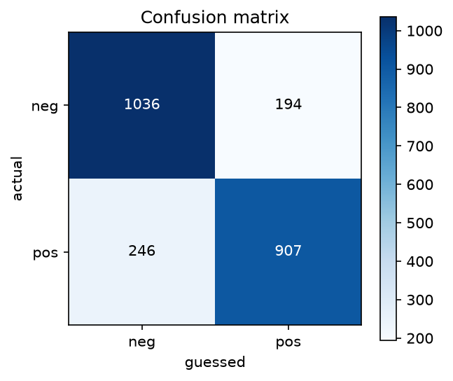
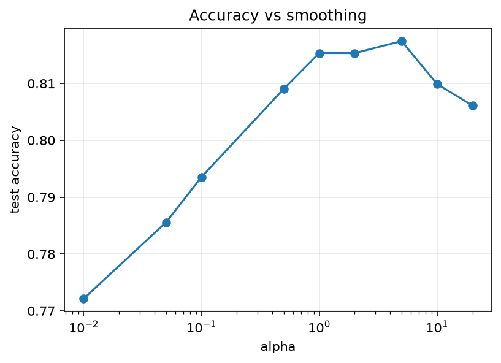

This assignment builds a sentiment classifier for customer reviews. You hand it a pile of reviews that are already marked positive or negative, it counts words, and then it guesses the sentiment of reviews it has never seen. 

## Naive Bayes

The idea is to pick whichever label makes the review you are looking at most likely. Bayes' rule gives

$$P(\text{label} \mid \text{words}) \propto P(\text{label}) \cdot P(\text{words} \mid \text{label})$$

$P(\text{label})$ is the **prior**, which is just how common that label is before you read a single word. $P(\text{words} \mid \text{label})$ is the **likelihood**, how likely this exact bag of words is if the review really is that label.

The naive part is pretending the words are independent of each other once you know the label. That is clearly false, since "not" sitting in front of "good" changes what "good" means, but it lets you write the likelihood as one factor per word:

$$P(\text{words} \mid \text{label}) = \prod_{w \in \text{doc}} P(w \mid \text{label})$$

Two things break if you implement that literally.

The first is underflow. Reviews here average 150 words, so you end up multiplying 150 numbers that are all smaller than 0.001, and floating point rounds the result to exactly zero. Taking the logarithm fixes it, because $\log(ab) = \log a + \log b$, so the product becomes a sum and the numbers stay in a sane range. Every probability in my model is stored as a log.

The second is zeros. If a word never showed up in the positive reviews, $P(w \mid \text{pos})$ is zero, and one zero factor drags the entire product to zero no matter how positive the other 149 words were. The fix is **smoothing**: pretend you saw every word $\alpha$ extra times before you started counting.

$$P(w \mid c) = \frac{\text{count}(w, c) + \alpha}{\left(\sum_{w'} \text{count}(w', c)\right) + \alpha |V|}$$

$|V|$ is the vocabulary size, the number of distinct words in the training set, and it shows up on the bottom so the probabilities over all words still add to 1. I used $\alpha = 1$, which is the usual starting point.

## The review data

The data is 11,914 customer reviews from Blitzer et al. (2007), covering six topics (books, camera, dvd, health, music, software). One review per line, already lowercased and split into words, with punctuation separated out as its own token. A line looks like this, wrapped here to fit the page:

```
music neg 241.txt i bought this album because i loved the
title song . it 's such a great song , how bad can the rest
of the album be , right ? ...
```

Column 0 is the topic, column 1 is the sentiment label, column 2 is a file id, and everything after that is the review. I only need columns 1 and 3 onward, so `read_documents` keeps `words[1]` as the label and `words[3:]` as the document.

```python
def read_documents(doc_file):
    docs = []
    labels = []
    with open(doc_file, encoding="utf-8") as f:
        for line in f:
            words = line.strip().split()
            docs.append(words[3:])
            labels.append(words[1])
    return docs, labels
```

The classes are nearly balanced, 6000 positive against 5914 negative. First 80% of the file goes to training (9531 reviews) and the last 20% to testing (2383). The file is already shuffled, so slicing it in order is fine.

## Part 1: Estimating the parameters

`train_nb` walks the training reviews once and builds a `Counter` of word counts per label, plus the vocabulary as a set. Then for each label it computes the log prior and the smoothed log probability of every word in the vocabulary.

It returns a dict with three keys: `labels`, `log_prior`, and `log_likelihood`. Nothing else downstream needs the raw counts, so they stay inside the function.

```python
def train_nb(documents, labels, alpha=1.0):
    counts = {}                      # label -> Counter of word -> count
    doc_counts = Counter(labels)     # label -> how many reviews have it
    vocab = set()

    for doc, label in zip(documents, labels):
        counts.setdefault(label, Counter()).update(doc)
        vocab.update(doc)

    n_docs = len(documents)
    v = len(vocab)

    log_prior = {}
    log_likelihood = {}

    for label, c in counts.items():
        log_prior[label] = np.log(doc_counts[label] / n_docs)
        total = sum(c.values()) + alpha * v
        log_likelihood[label] = {w: np.log((c[w] + alpha) / total) for w in vocab}

    return {
        "labels": list(counts),
        "log_prior": log_prior,
        "log_likelihood": log_likelihood,
    }
```

The vocabulary came out to 52,392 distinct words, with about 715k word tokens in the negative class and 721k in the positive. Two quick checks that the counting worked:

- `np.exp(model["log_prior"]["pos"])` is 0.5086, which matches 6000 positive reviews out of 11,914.
- `model["log_likelihood"]["pos"]["great"]` is -5.953, a plain negative number, so nothing blew up.

## Part 2: Scoring a document

`score_doc_label(document, label, model)` starts at the log prior for that label and adds the log likelihood of each word in the document. That sum is the log of the whole Naive Bayes product.

```python
def score_doc_label(document, label, model):
    log_prob = model["log_prior"][label]
    likelihood = model["log_likelihood"][label]

    for word in document:
        if word in likelihood:
            log_prob += likelihood[word]

    return log_prob
```

Words that are not in the vocabulary get skipped. They appeared zero times for every label, so they would contribute the same amount to each label's score and cannot change which one wins. Skipping them also means the dictionary lookup never raises a `KeyError`.

### Sanity check 1

Scoring the one word documents `["great"]` and `["bad"]`, converted back to probabilities with `np.exp`:

| document | neg | pos |
| --- | --- | --- |
| `["great"]` | 0.000528 | 0.001321 |
| `["bad"]` | 0.000455 | 0.000172 |

"great" is about 2.5 times more likely under positive, "bad" is about 2.6 times more likely under negative, and both land in the 0.001 to 0.002 range the handout predicted. That is the expected behaviour.

### Sanity check 2

`["a", "top-quality", "performance"]` returns -13.49 for negative and -12.81 for positive. No crash. "top-quality" is genuinely absent from the training vocabulary, so this does exercise the skip branch, and the other two words carry the decision.

## Part 3: Classifying

`classify_nb` scores the document under every label and returns whichever one scored highest. It tracks the best score in a variable seeded to negative infinity so the first label always wins the first comparison.

`classify_documents` runs that over a list of documents and returns the list of guesses.

```python
def classify_nb(document, model):
    best_label = None
    best_score = -np.inf

    for label in model["labels"]:
        score = score_doc_label(document, label, model)
        if score > best_score:
            best_label = label
            best_score = score

    return best_label


def classify_documents(docs, model):
    return [classify_nb(doc, model) for doc in docs]
```

## Part 4: Evaluation

`accuracy` zips the true labels against the guesses, counts the positions where they match, and divides by the total.

```python
def accuracy(true_labels, guessed_labels):
    correct = 0

    for t, g in zip(true_labels, guessed_labels):
        if t == g:
            correct += 1

    return correct / len(true_labels)
```

**On the 2383 test reviews the classifier gets 0.8154, so about 81.5% correct.** For reference, always guessing the more common label would get about 50%, so the model is doing real work.

### Where the errors sit



A **confusion matrix** is a table of actual label against guessed label, so the diagonal is the correct answers and everything off it is a mistake. 1036 + 907 = 1943 right out of 2383, and the two error cells are not even: 246 positive reviews got called negative against 194 negatives called positive. So the classifier leans slightly negative, which lines up with the error analysis below, where every example it was most confidently wrong about was a positive review.

### Picking alpha



Retraining at a few values of $\alpha$ and scoring each one on the test set gives a curve with a clear shape. Tiny values like 0.01 do badly (77.2%) because barely-smoothed counts let a single rare word dominate the sum. Accuracy climbs to a flat peak around $\alpha = 1$ to $5$, topping out at 81.8%, then falls off again past 10 as the smoothing swamps the actual counts and every word starts to look equally likely under both labels. The default $\alpha = 1$ is within 0.2 points of the best value, so I left it there.

## Part 5: Error analysis

I pulled every test review the classifier got wrong, kept the ones under 40 words so they are readable, and sorted by margin. Margin here means the wrong label's score minus the right label's score, in log units, so a big margin is the classifier being confidently wrong instead of narrowly wrong.

```python
short_errors = []

for i in range(len(test_docs)):
    doc = test_docs[i]
    true_label = test_labels[i]
    guess_label = guesses[i]

    if true_label == guess_label or len(doc) > 40:
        continue

    margin = score_doc_label(doc, guess_label, model) - score_doc_label(doc, true_label, model)
    short_errors.append((margin, i))

short_errors.sort(reverse=True)
```

The top three:

**Margin 8.09, actually positive, guessed negative**

> "i bought zonealarm internet security suite for the included zonealarm pro firewall ( it cost much less that way ) . if i did n't already have norton antivirus , i 'd use the antivirus , too"

There is almost no sentiment vocabulary in here at all. It is a factual description of a purchase, and the only strong signal is `n't`, which shows up constantly in negative reviews. The writer is being positive by saying they would happily use the antivirus too, but that requires following a hypothetical across a whole sentence, and a word counter cannot do that.

**Margin 5.48, actually positive, guessed negative**

> "this movie is a reallllllllllllly scary movie . the only part i did n't like was that pervert mikks in the beginning . be warned of grossness . that is all i need to say"

`scary`, `pervert`, `grossness` and `warned` are all negative words in general, but in a review of a horror movie "scary" is the compliment. The model has no idea what topic it is reading, so it cannot know that. On top of that, "the only part i did n't like" is a positive construction built entirely out of negative words.

**Margin 4.73, actually positive, guessed negative**

> "excellent service , and the product worked extremely well . the only criticism i would have is the cost of postage . it was ridiculous , the product came in a big parcel , and inside was a dvd ."

This one has strong positive words at the front (`excellent`, `worked`, `well`) but then spends most of its length on the shipping complaint, with `criticism` and `ridiculous` in it. Bag of words has no sense of proportion or structure, so a short bit of praise followed by a long gripe looks like a negative review even though the gripe is explicitly flagged as the only problem.

The common thread is negation and context. All three are positive reviews read as negative, and in every case the words themselves lean negative while the sentence structure around them does not. The Pang et al. (2002) negation trick, tagging every word after a "not" or "n't" until the end of the sentence, would probably help on the first two. Bigrams would catch "did n't like" as a single feature instead of three unrelated ones.
