This assignment uses the simple_rl library to poke at two ways of solving a gridworld. Problem 1 is value iteration, where the agent already knows exactly how the world works and just has to compute the best move from every square. Problem 2 is Q-learning, where the agent knows nothing up front and has to figure it out by wandering around and seeing what happens.

## MDPs and value iteration

A **Markov decision process** (MDP) is the setup both problems live in. There is a set of states $S$ (here, the squares of the grid), a set of actions $A$ (up, down, left, right), a transition function $P(s' \mid s, a)$ that says where you end up if you take action $a$ in state $s$, a reward $R(s, a, s')$ you get for that move, and a discount factor $\gamma$ between 0 and 1.

The gridworld is slippery. With probability 0.95 you go where you meant to, and with probability 0.05 you slide in one of the two perpendicular directions instead. Walking into a wall or off the edge leaves you where you were. Every normal square costs $-0.1$, the goal gives $+1$, the lava gives $-1$, and both goal and lava end the episode.

The **value** $V(s)$ of a state is the total discounted reward you expect to collect starting from $s$ if you play well from then on. **Value iteration** (VI) finds it by starting every state at 0 and repeatedly applying the Bellman backup

$$V_k(s) = \max_a \sum_{s'} P(s' \mid s, a) \left( R(s, a, s') + \gamma V_{k-1}(s') \right)$$

to every state. Each pass is one iteration. It stops when the biggest change in any state between two passes is smaller than a threshold $\delta$ (delta). The **policy**, the arrow drawn in each square, is just whichever action won the max.

$\gamma$ is how much the agent cares about the future. A reward $t$ steps away is worth $\gamma^t$ of what it would be worth right now, so when $\gamma$ is near 1, it means patient and when $\gamma$ is near 0 means only the next step matters.

## Problem 1: Value iteration

### (a) The gridworld

A 4 by 4 grid with the agent (triangle) starting bottom left, a wall right above it, the goal (green) in the top right and lava (red) right below the goal.

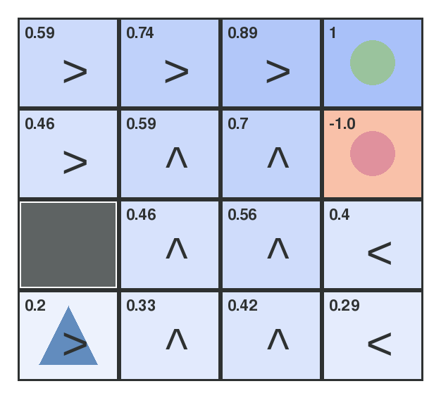

### (b) Changing gamma

I kept $\delta$ at the default of 0.0001 and ran $\gamma$ at 0.9, 0.7, 0.1 and 0.001.

| $\gamma$ | iterations | value at start |
| --- | --- | --- |
| 0.9 | 7 | 0.08 |
| 0.7 | 7 | -0.15 |
| 0.1 | 4 | -0.11 |
| 0.001 | 3 | -0.1 |

::: {.gallery}
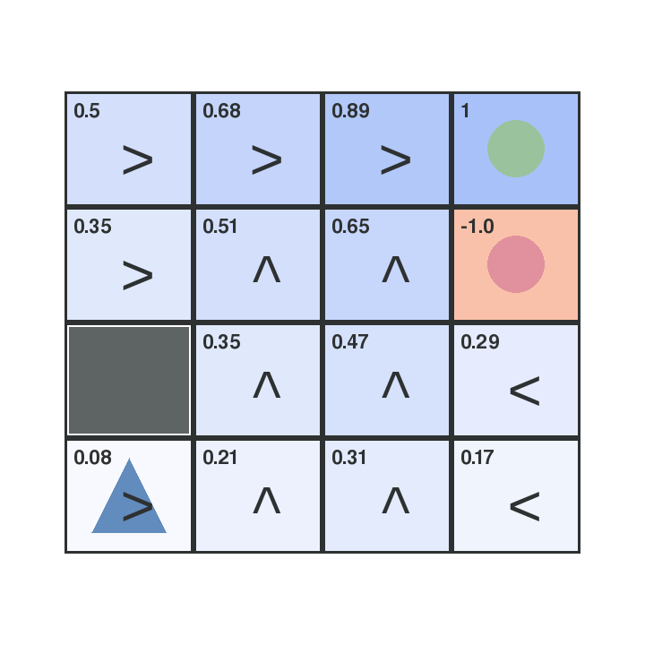

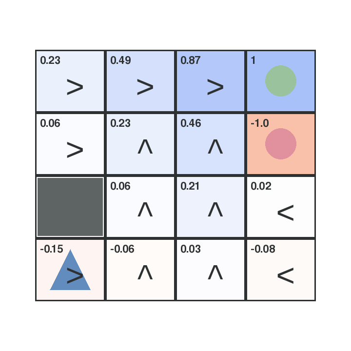

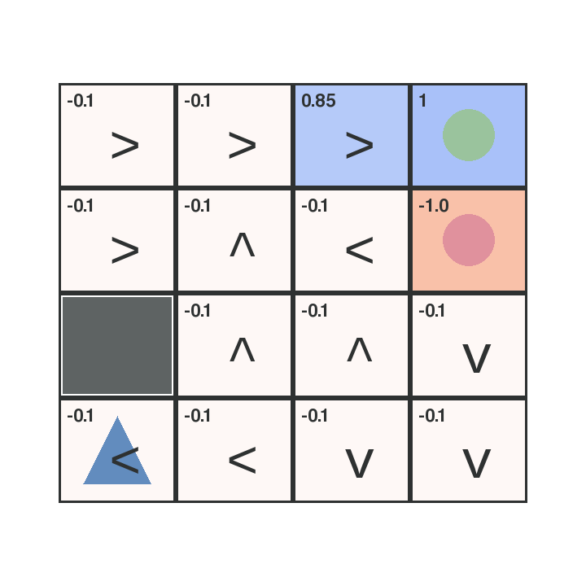
:::

**(i)** At 0.9 and 0.7 the policy is the same. From the start it goes right, up the middle columns and then right along the top row into the goal, which is 6 moves and a shortest path. It never goes up the right column, since that walks straight into the lava, and the two squares in the bottom right point left to steer away from it. So it does take a shortest path, but out of all the shortest paths it picks one that does not go near the lava. The only thing that changes between 0.9 and 0.7 is the values, which drop off faster as you get further from the goal. At 0.7 the start square is actually negative, because the $+1$ is discounted so hard by the time it gets back there that the step costs win.

At 0.1 and 0.001 it falls apart. Only the square right next to the goal (0.85) knows the goal is there. Every other square has a value of about $-0.1$, which is just the cost of one step, because anything two or more steps away gets multiplied by $\gamma^2 \approx 0.01$ or less and basically disappears. Since every action looks equally bad from those squares, the arrows are arbitrary, and from the start square it points left into the edge of the grid.

So $\gamma$ sets how far ahead the agent looks. With a high $\gamma$ the reward at the goal spreads back across the whole grid and the agent will put up with step costs to get there. With a tiny $\gamma$ the agent only sees one step ahead, so unless it is already next to the goal it has no reason to move toward it. It also takes fewer iterations, since there is less future to propagate back.

**(ii)** With $\gamma = 1$ it converges in 8 iterations.

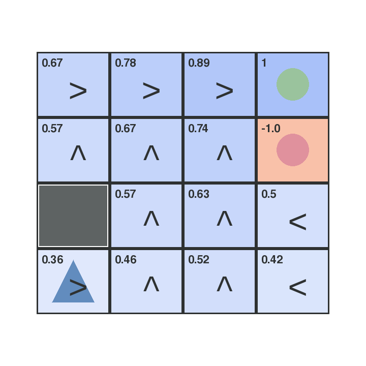

The convergence guarantee for VI comes from $\gamma < 1$ shrinking the error every pass. At $\gamma = 1$ that is gone, but it still converges here because the goal and lava are terminal. Every square can reach one of them in a few steps, so the total reward along any path is a finite sum of step costs plus the terminal reward, and the values settle after the information from the goal has had time to travel back to the start. The values come out as roughly $1 - 0.11$ per step away from the goal, which is just the step costs being added up undiscounted.

To make it not converge, take away the way out. If you wall the agent off from both the goal and the lava (like part d), every step costs $-0.1$ forever and nothing ever ends the episode, so with $\gamma = 1$ the value of the trapped squares goes down by 0.1 every single iteration and never settles. It would run until the 500 iteration cap.

### (c) Changing delta

Same grid, $\gamma$ at the default of 0.95, and $\delta$ from 1 down to 0.0001.

| $\delta$ | iterations |
| --- | --- |
| 1 | 1 |
| 0.1 | 4 |
| 0.01 | 6 |
| 0.001 | 7 |
| 0.0001 | 8 |

::: {.gallery}
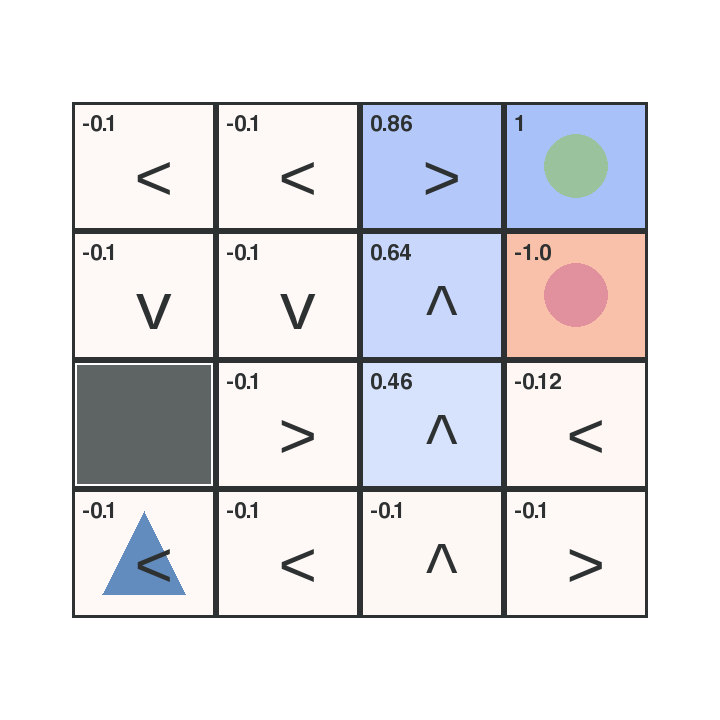

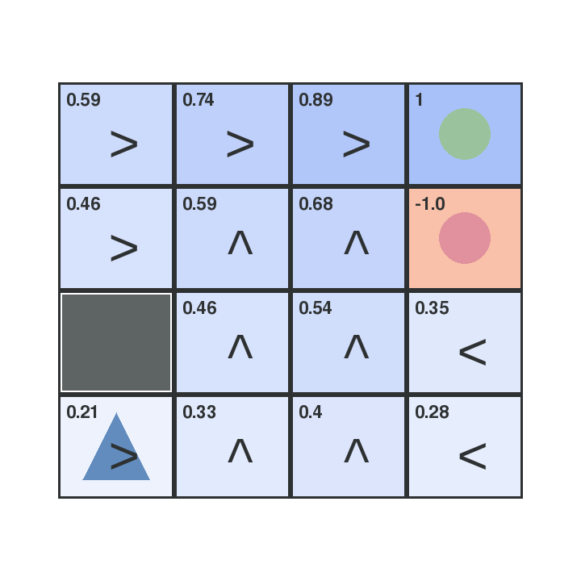
:::

Smaller $\delta$ means more iterations, but not many more. Each time $\delta$ gets 10 times tighter it only adds 1 or 2 iterations. That is because the error shrinks by a factor of about $\gamma$ every pass, so getting it 10 times smaller costs a fixed number of extra passes, a logarithmic relationship. It is also a tiny grid with nearby terminal states, so once the goal value has spread to the start in about 6 passes there is not much left to change.

$\delta = 1$ is way too loose. It stops after one pass, when only the squares closest to the goal have been updated, so the rest of the grid is still at $-0.1$ and the policy at the start points left into the wall. By $\delta = 0.0001$ it matches the picture from part a.

### (d) A trapped agent

Agent at (1,1), walls at (1,2), (2,1) and (2,2) so it is boxed into the corner, goal in the top right, everything else default ($\gamma = 0.95$, $\delta = 0.0001$). It took 136 iterations.

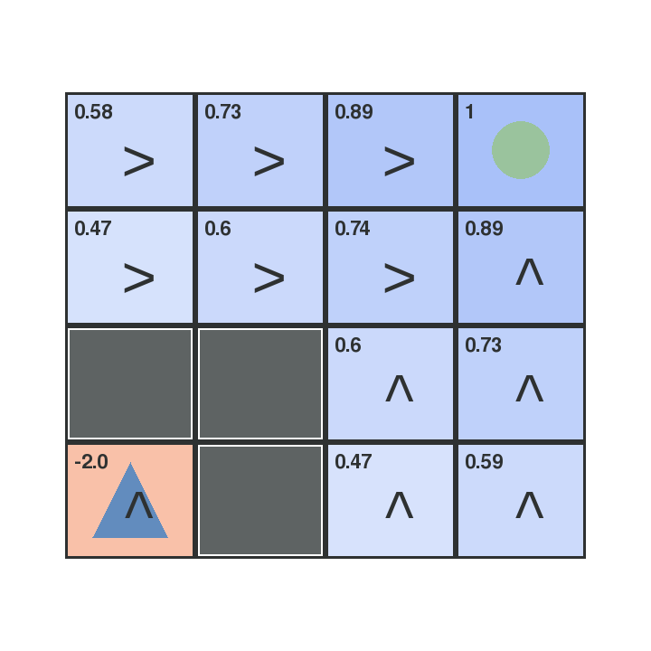

**(i)** No. Every square other than the start still has a normal looking value (0.47 to 0.89) and a sensible policy pointing at the goal. VI does not care where the agent starts. It sweeps every state in the MDP, and from those squares the goal is reachable, so they get real values. The only state that is cut off is the start itself, and it gets $-2.0$.

**(ii)** Yes, it converges to $-2$. In the start square every action, including the 0.05 slips, hits a wall or the edge, so the agent stays put with probability 1 and collects $-0.1$. The backup for that state collapses to

$$V_k(s_0) = -0.1 + 0.95\, V_{k-1}(s_0)$$

Starting from $V_0 = 0$ that gives $-0.1$, then $-0.195$, then $-0.285$, and in general

$$V_k(s_0) = -0.1 \sum_{i=0}^{k-1} 0.95^i = -0.1 \cdot \frac{1 - 0.95^k}{1 - 0.95} = -2\,(1 - 0.95^k)$$

As $k \to \infty$, $0.95^k \to 0$ and $V \to -2$. You can also get it straight from the fixed point, $V = -0.1 + 0.95V$, so $V = -0.1/0.05 = -2$.

That also explains the 136 iterations. The change at pass $k$ is $0.1 \cdot 0.95^{k-1}$, and that first drops under $\delta = 0.0001$ when $k - 1 > \ln(0.001)/\ln(0.95) \approx 134.7$, so at $k = 136$. Every other square converges way earlier, the trapped one is what keeps it running.

### (e) Bigger grids

Default everything, just changing the width and height.

| grid | states | iterations | time (s) |
| --- | --- | --- | --- |
| 5 x 5 | 25 | 7 | 0.285 |
| 10 x 10 | 100 | 13 | 0.904 |
| 15 x 15 | 225 | 19 | 1.560 |
| 20 x 20 | 400 | 29 | 2.874 |
| 25 x 25 | 625 | 40 | 4.840 |

::: {.gallery}
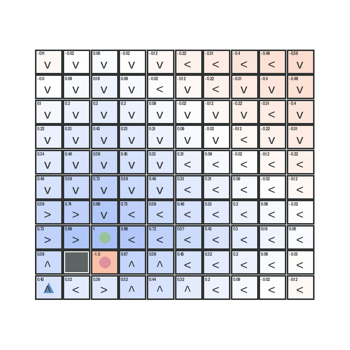

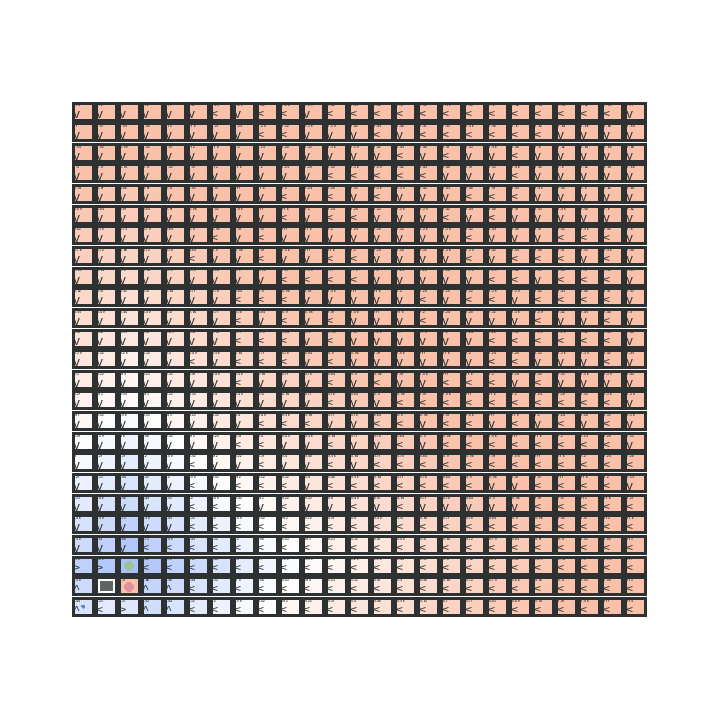
:::

**(i)** Time goes up with the number of states, and faster than the iteration count alone would explain, since bigger grids need both more iterations (7 to 40) and more work per iteration. Going from 25 to 625 states is 25 times as many states and about 17 times the time. Part of the reason it is not more is a fixed overhead of about 0.2 s, which is what every 4 by 4 run in parts b and c took no matter what.

**(ii)** One iteration runs the backup once for every state. For each of the $|S|$ states it tries each of the $|A|$ actions, and for each action it sums over every possible next state $s'$, which is another $|S|$ terms, each constant time since $V_{k-1}(s')$ is a lookup. That gives

$$O(|S| \cdot |A| \cdot |S|) = O(|S|^2 |A|)$$

per iteration.

**(iii)** They do not match. If one iteration were really $O(|S|^2)$, going from 25 to 625 states would make each iteration 625 times slower, before even counting the extra iterations, and the measured time only went up 17 times. The $|S|^2$ comes from the inner sum over every $s'$, but in a gridworld almost all of those terms are zero. From any square you can only land in the square you aimed for, one of the two perpendicular ones, or stay put, so there are at most a handful of $s'$ with nonzero probability. The library only keeps those, so the inner sum is effectively constant and one iteration acts like $O(|S||A|)$. The big O in (ii) is the worst case for an MDP where any state can lead to any other, the gridworld is a lot sparser than that.

## Problem 2: Q-learning

**Q-learning** learns a value for each state and action pair, $Q(s, a)$, the expected discounted reward of taking $a$ in $s$ and playing well after. It does not need $P$ or $R$. The agent just acts, sees the reward $r$ and the next state $s'$, and nudges its estimate toward what it saw:

$$Q(s, a) \leftarrow (1 - \alpha)\, Q(s, a) + \alpha \left( r + \gamma \max_{a'} Q(s', a') \right)$$

$\alpha$ (alpha) is the **learning rate**, how far each new sample moves the estimate. $\epsilon$ (epsilon) controls **exploration**: with probability $\epsilon$ the agent takes a random action, otherwise it takes the action with the highest $Q$. Every $Q$ starts at 0.

The defaults are a 10 by 10 grid with some walls and lava, goal at (10, 8), $\gamma = 0.95$, $\alpha = 0.2$, $\epsilon = 0.1$, uniform exploration. Each run is 5 instances of 60 episodes, 200 steps max per episode, and the plots show cumulative reward against a random agent. Every step costs $-0.1$, so cumulative reward always goes down, and the flatter the line, the faster the agent is reaching the goal.

### (a) Value iteration on Gym problems

No, VI would not work on CartPole, MountainCar or Atari. VI needs two things those do not give you. It needs the model, $P(s' \mid s, a)$ and $R$, written down for every state and action, but in Gym you only get to step the environment and see what comes back. And it needs to loop over every state on every pass. CartPole and MountainCar have continuous states (positions and velocities), so there are infinitely many, and Atari states are raw screen images, so the number of possible states is astronomically large.

Q-learning gets around both. It is **model-free**, it learns from the samples $(s, a, r, s')$ it actually experiences, so it never needs $P$ or $R$. It also only updates states the agent actually visits, so it never has to enumerate the whole state space, and because the update is just a target to move toward, the table of $Q$ values can be swapped for a function approximator like a neural network that generalizes across similar states, which is how it gets used on Atari.

### (b) Changing epsilon

| $\epsilon$ | Q-learning | random |
| --- | --- | --- |
| 0 | -501.0 | -568.3 |
| 0.01 | -490.5 | -580.0 |
| 0.1 (default, from part d) | -483.8 | -576.5 |
| 0.5 | -348.7 | -569.1 |
| 0.99 | -538.0 | -591.2 |
| 1 | -582.5 | -576.9 |

::: {.gallery}
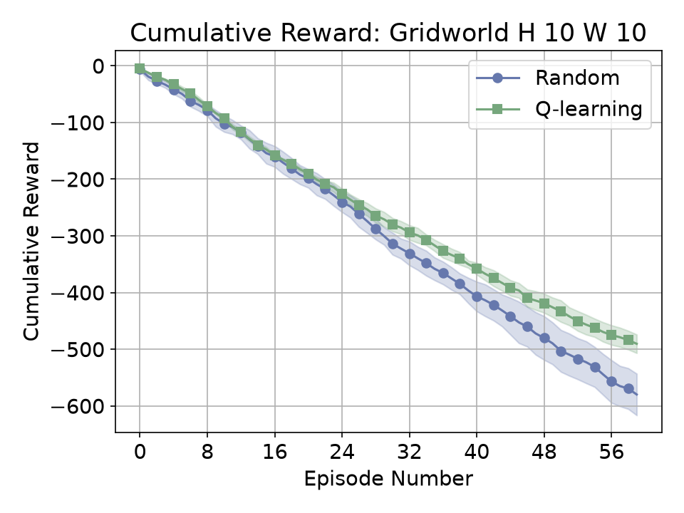

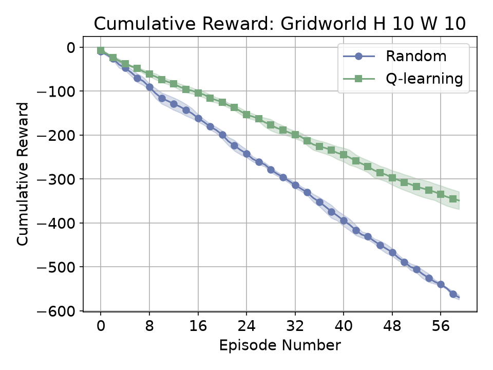

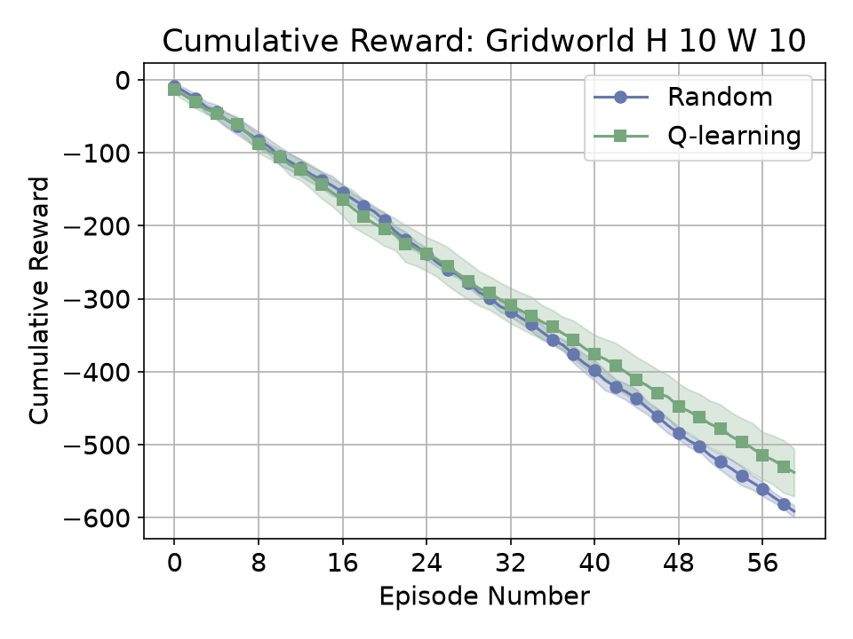
:::

The best was in the middle at 0.5, where the Q-learning line pulls away from random early and is clearly flattening by the end. Low $\epsilon$ (0.01) still beats random but learns slowly, because it mostly does whatever it currently thinks is best and rarely tries anything new, so it is slow to discover the route to the goal. High $\epsilon$ (0.99) is barely better than random, because even though it is learning good $Q$ values in the background it almost never actually uses them. Over only 60 episodes on a grid this size, a lot of exploring paid off.

**(i)** At $\epsilon = 1$ the agent always picks a random action, so it is literally a random agent. It still updates its $Q$ values, it just never acts on them, so its curve lands right on top of the random one (-582.5 vs -576.9).

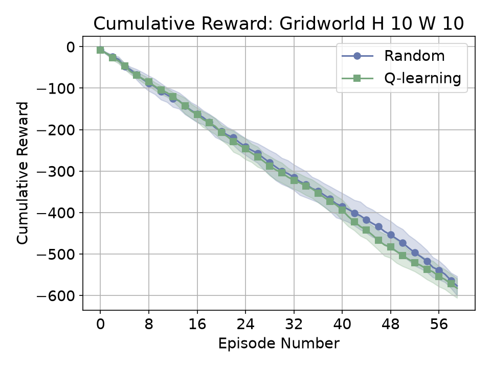

**(ii)** At $\epsilon = 0$ it always takes the greedy action. It tracks random for the first 30 or so episodes and then starts slowly pulling ahead, ending at -501.

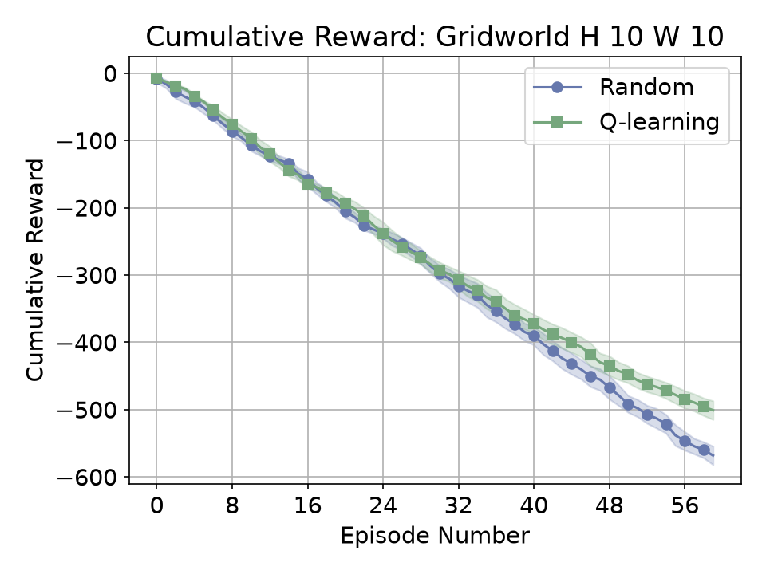

It still learns at all because every $Q$ starts at 0 and every step costs $-0.1$. Any action it tries gets pushed below 0, so the actions it has not tried yet look better by comparison and the greedy choice ends up trying them. That gives it some exploration for free, but it is a slow systematic kind, and once it has a path that works it has no reason to look for a better one, so it gets stuck on whatever it found first.

### (c) Changing alpha

| $\alpha$ | Q-learning | random |
| --- | --- | --- |
| 0.01 | -713.5 | -594.7 |
| 0.5 | -365.4 | -599.1 |
| 0.99 | -277.9 | -562.4 |

::: {.gallery}
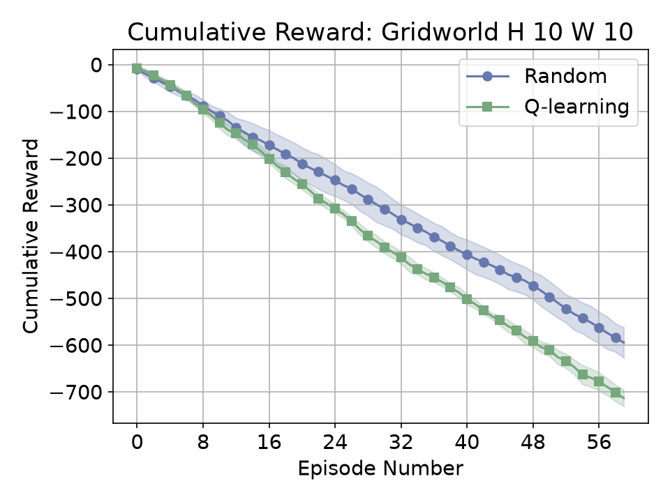

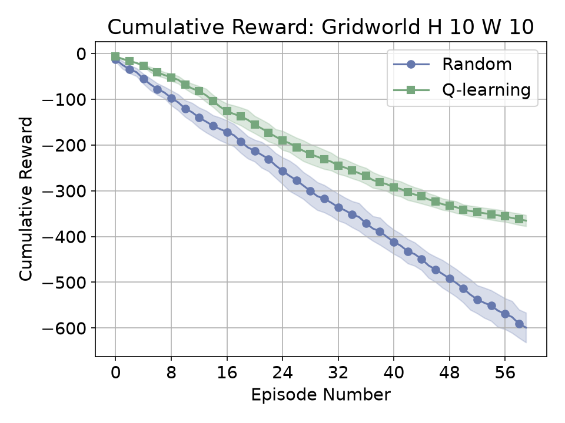

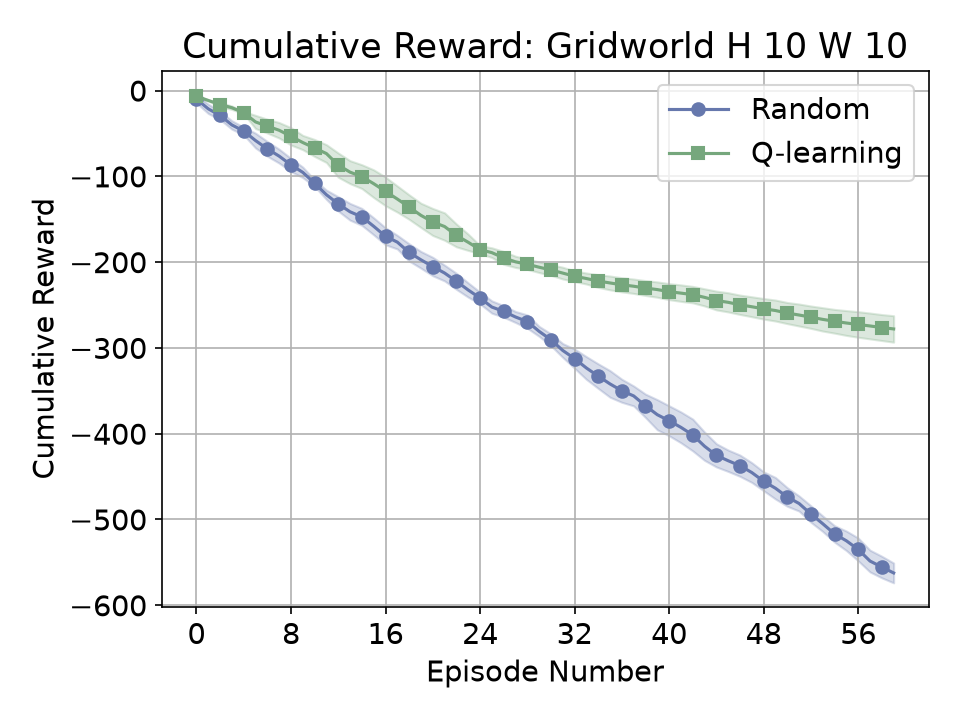
:::

Bigger $\alpha$ was better across the board, and $\alpha = 0.01$ was actually worse than random. With $\alpha = 0.01$ each update only moves $Q$ 1% of the way toward the new sample, so 60 episodes is nowhere near enough to learn anything, and the agent spends the whole time acting greedily on $Q$ values that are still basically 0 plus noise. That makes it worse than random, since it keeps committing to the same bad moves instead of at least wandering around.

$\alpha = 0.99$ basically replaces the old estimate with the latest sample every time. That is normally risky in a noisy environment, since one unlucky slip overwrites everything, but here the world is 95% deterministic, so the latest sample is almost always right and trusting it fully is the fastest way to learn.

### (d) Uniform vs softmax exploration

**Uniform** exploration is the $\epsilon$-greedy rule above, where exploring means picking any action with equal chance. **Softmax** exploration picks every action with probability proportional to $e^{Q(s,a)/\beta}$, with $\beta = 0.2$ in the library, so better actions get picked more often but worse ones still get tried sometimes.

| exploration | Q-learning | random |
| --- | --- | --- |
| uniform | -483.8 | -576.5 |
| softmax | -573.4 | -577.0 |

::: {.gallery}
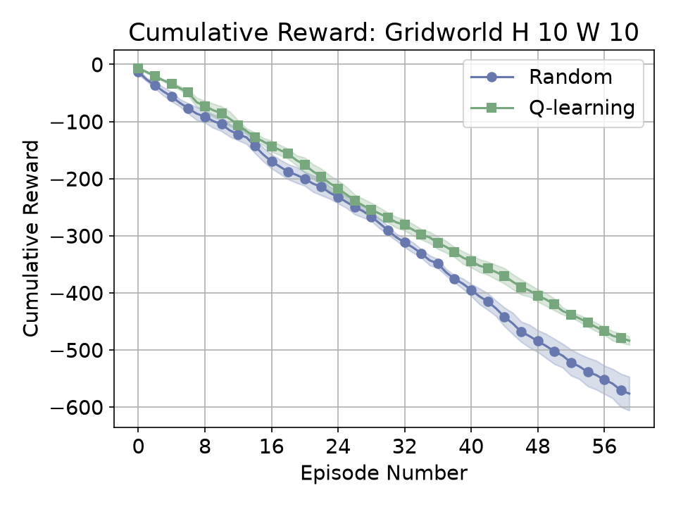

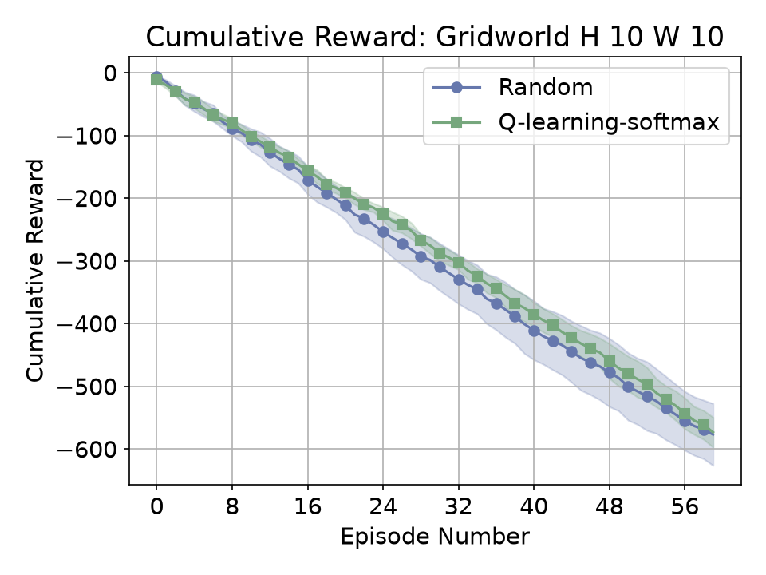
:::

Uniform clearly beats random by the end, softmax barely does. Early on all the $Q$ values are near 0 and close together, so $e^{Q/\beta}$ is about the same for every action and softmax is basically choosing at random. It only starts favouring good actions once their $Q$ values are clearly separated, and with a step cost of $-0.1$ and the goal far away that takes a long time to happen. Uniform on the other hand takes the greedy action 90% of the time from the very start, so as soon as there is any difference between actions it acts on it. In both plots the agent's line follows random for the first stretch and then flattens out as it starts finding the goal more reliably, the softmax one just flattens a lot later and a lot less.

### (e) Annealing

**Annealing** means shrinking $\alpha$ and $\epsilon$ as the agent gains experience. In simple_rl both get divided by $1 + \frac{\text{step}}{1000} \cdot \frac{\text{episode} + 1}{2000}$, so they start at their set values and slowly decay.

It helps because what you want early on is the opposite of what you want later. At the start the agent knows nothing, so it should explore a lot and take big learning steps. Later its $Q$ values are mostly right, so random exploring just wastes steps and large updates just let single unlucky slips knock good estimates around. Annealing moves the agent from exploring to exploiting on its own, instead of being stuck with one fixed tradeoff for the whole run, and a decaying learning rate is also what the convergence proof for Q-learning needs.

When I toggled it on, the agent learned a little slower at first, since $\alpha$ was already shrinking while its $Q$ values were still bad. By the last 100 episodes it was the steadier of the two: $\epsilon$ had decayed from 0.1 to about 0.02, so it almost never took a random step into lava and went straight for the goal, while the non-annealed agent kept stumbling into lava now and then because it explores 10% of the time forever.

### (f) Blocking off the start

I added a wall at (1, 2) on top of the default walls, which already had (2, 1), so the agent at (1, 1) is boxed into the corner.

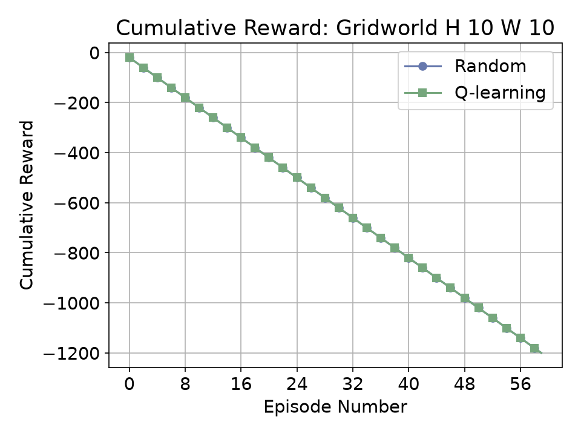

Both lines are exactly on top of each other, a perfectly straight line down to -1200 with zero spread between instances. That is $-0.1 \times 200$ steps $= -20$ per episode, times 60 episodes. The agent can never leave the start square, so every episode it bumps into walls for all 200 steps and the episode times out. It does learn, every $Q(s_0, a)$ goes down toward the same value, but every action leads to the same place with the same reward, so there is nothing to tell them apart and nothing learning can do to improve. The random agent is in the same box, so they get the identical reward. It is the same thing as part 1d, just learned from samples instead of computed, where VI would give the start square a value of $-2$.
